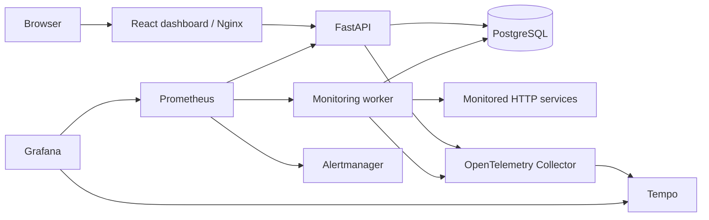

# InfraPulse

[](https://github.com/jacivaldocarvalho/jc-infrapulse/actions/workflows/ci.yml)
[](backend/pyproject.toml)
[](backend/pyproject.toml)
[](compose.yaml)
[](LICENSE)

InfraPulse is an API reliability and observability platform. It registers HTTP services, checks them through a dedicated worker, stores results in PostgreSQL, and exposes status, history, and reliability metrics through a FastAPI API and a React dashboard. The repository also includes local observability infrastructure and CI validation for application code, images, and evidence artifacts.

## Project status

| Status | Scope |
| --- | --- |
| **Implemented** | Service registration, scheduled HTTP checks, persisted history, reliability views, React dashboard, local observability stack, and CI checks for code, integration, images, and evidence. |
| **In progress** | Public-facing documentation is being refined; no active deployment milestone is documented. |
| **Planned** | The roadmap below identifies work needed before a production deployment. |

## What it does

- **Service registry:** create, list, update, and delete monitored HTTP services through `/api/v1/services`.
- **HTTP monitoring:** scheduled checks with URL and resolved-address controls, timeout limits, and persisted results.
- **Reliability views:** current status, check history, availability, and response-time summaries derived from stored checks.
- **Dashboard:** a React interface for service status and historical metrics.
- **Operations:** `/health` checks process liveness; `/ready` checks database connectivity. Prometheus metrics and OpenTelemetry traces feed Grafana, Tempo, and Alertmanager in the local Compose stack.
- **Supply-chain validation:** CI workflows cover quality checks, integration tests, image validation, SBOMs, and provenance evidence. See the [architecture](docs/architecture.md) for exact workflow boundaries.

## Architecture



The API handles requests and persistence; the worker performs checks independently. Compose publishes the API, dashboard, and Grafana on loopback. See [architecture details](docs/architecture.md) and [ADRs 0001–0003](docs/adr/0001-http-monitoring.md): [observability](docs/adr/0002-observability-architecture.md), [dashboard](docs/adr/0003-frontend-dashboard.md).

## Stack

| Area | Technology |
| --- | --- |
| API and worker | Python 3.12+, FastAPI, Pydantic v2, SQLAlchemy 2.x, Alembic |
| Data | PostgreSQL 17 |
| Dashboard | React, TypeScript, Vite, Nginx |
| Observability | Prometheus, OpenTelemetry Collector, Tempo, Grafana, Alertmanager |
| Development and quality | Docker Compose, pytest, httpx, Ruff, mypy, frontend test tooling |

## Engineering practices

| Discipline | Evidence in this repository |
| --- | --- |
| DevOps | Docker Compose defines the local stack; GitHub Actions validates code, integration, and container images without deploying them. |
| DevSecOps | Monitoring enforces URL and resolved-address controls; CI validates image builds and generates SBOM and provenance evidence, with a separate informational vulnerability audit. |
| SRE | Health and readiness endpoints, persisted check history, Prometheus metrics, OpenTelemetry traces, and local dashboards support diagnosis. No SLO is defined. |
| Backend | FastAPI separates API requests from the monitoring worker; SQLAlchemy, Alembic, pytest, Ruff, and mypy support persistence and code quality. |
| Frontend | React and TypeScript provide the dashboard; CI generates API types from the OpenAPI contract and runs frontend quality, unit, build, and browser checks. |

The [architecture](docs/architecture.md) and [CI workflow](.github/workflows/ci.yml) describe these boundaries in detail.

## Run locally

Requirements: Docker with Compose v2+. From the repository root:

```bash
cp backend/.env.example backend/.env
```

Set distinct local values for `POSTGRES_PASSWORD` and `GRAFANA_ADMIN_PASSWORD` in `backend/.env`. This file is ignored by Git. Then run:

```bash
docker compose --env-file backend/.env build api worker
docker compose --env-file backend/.env up -d --wait db
docker compose --env-file backend/.env run --rm --no-deps api alembic upgrade head
docker compose --env-file backend/.env up -d --wait
curl http://127.0.0.1:8000/health
curl http://127.0.0.1:8000/ready
```

Open the [API docs](http://127.0.0.1:8000/docs), [dashboard](http://127.0.0.1:8080), or [Grafana](http://127.0.0.1:3000). To stop the stack while retaining volumes, run `docker compose --env-file backend/.env down`.

## Tests and quality

For backend development, install the locked development dependencies in a Python 3.12+ environment:

```bash
python3 -m venv backend/.venv
PATH="$PWD/backend/.venv/bin:$PATH" bash backend/install-locked.sh dev --editable
cd backend
.venv/bin/pytest
.venv/bin/ruff check .
.venv/bin/ruff format --check .
.venv/bin/mypy
```

The [CI workflow](.github/workflows/ci.yml) includes additional integration and frontend checks. These commands document how to run checks; this README makes no claim about their current result. See [frontend operations](docs/operations/frontend.md) for its development and test commands.

## Scope and limitations

The Compose configuration is intended for local development, not a hardened public deployment. Authentication and authorization are not implemented. The worker is designed for a single replica. PostgreSQL check history has no automatic retention policy. Alertmanager has no external notification integration by default. Health endpoints, metrics, and dashboards should be exposed only behind controls appropriate to the deployment.

## Production readiness

**Implemented:** health and readiness checks, monitoring history, telemetry, and CI validation provide a foundation for operating and reviewing the application.

No production environment, continuous deployment pipeline, or production readiness sign-off is documented here.

**Planned:** address the deployment, access control, retention, notification, and worker scaling gaps described above before treating the service as production ready.

## Roadmap

The following items are **planned**, not delivered commitments:

- **Observability and reliability:** define service objectives and alerting policies, then evaluate retention and recovery requirements.
- **Deployment automation:** design a controlled deployment pipeline with verification and rollback steps.
- **Security:** add authentication and authorization, review public exposure, and define an operational vulnerability response process.
- **Future deployment:** assess an appropriate hosting model and infrastructure automation after production requirements are defined; no Kubernetes deployment is currently provided.

## Documentation

- [Architecture](docs/architecture.md) and [ADRs](docs/adr/0001-http-monitoring.md)
- [Monitoring operations and URL policy](docs/operations/monitoring.md)
- [Observability operations](docs/operations/observability.md)
- [Frontend operations](docs/operations/frontend.md)
- [CI evidence and provenance](docs/ci-evidence-f3c2.md)

## Project resources

- [Documentation index](docs/README.md): entry point for architecture, decisions, operations, and sprint history.
- [Contributing guide](CONTRIBUTING.md): development workflow and pull request guidance.
- [Security policy](SECURITY.md): private vulnerability reporting guidance.
- [Changelog](CHANGELOG.md): changes recorded from Git history.
- [EditorConfig](.editorconfig): shared basic editor settings.
- [Pull request template](.github/PULL_REQUEST_TEMPLATE.md): prompts for change summaries and verification.

The MIT license is described below.

## License

InfraPulse is released under the [MIT License](LICENSE). Third-party components retain their own licenses and notices.
