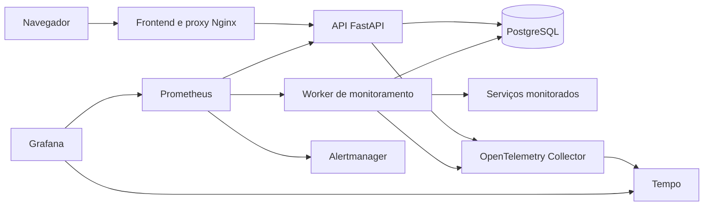
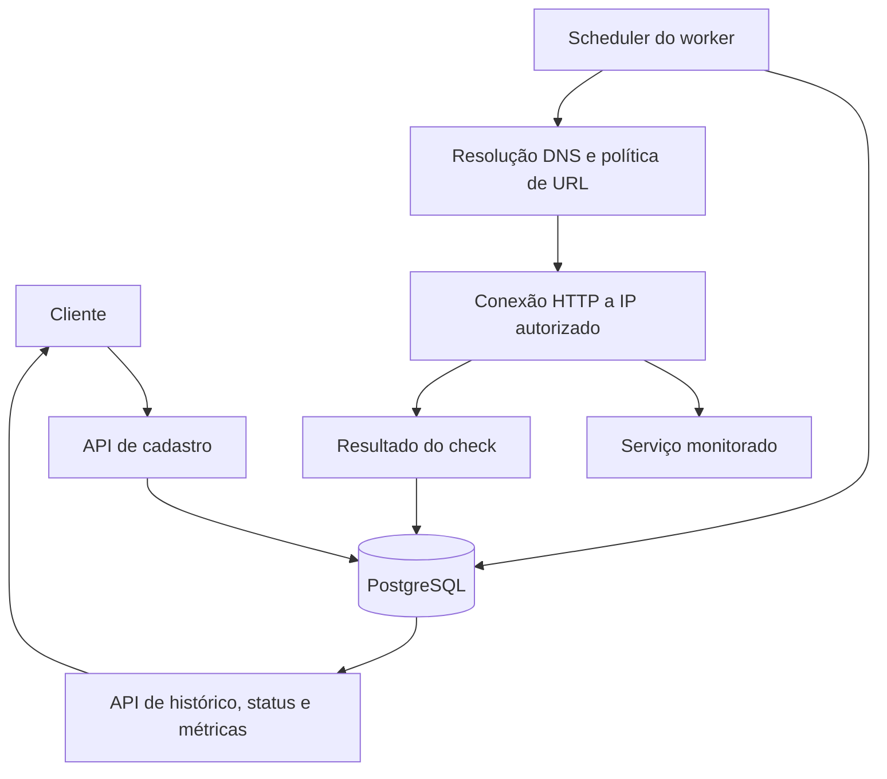
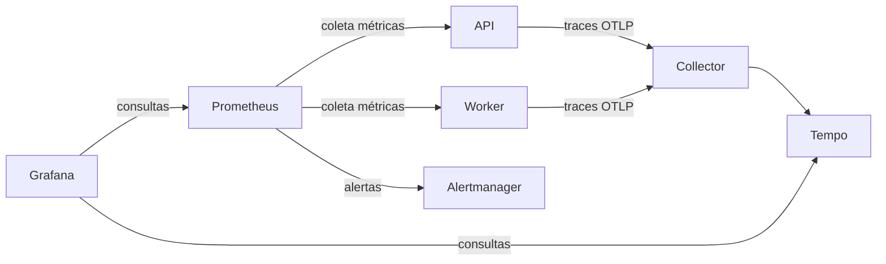
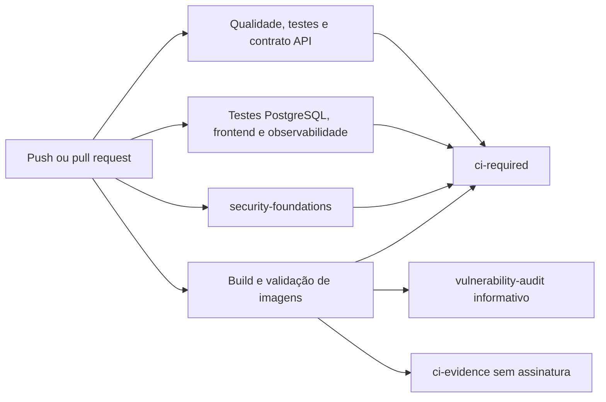

# Arquitetura do InfraPulse

Esta visão descreve a implementação local e o workflow CI deste checkout. A stack
Compose é destinada ao desenvolvimento; o produto não oferece autenticação ou
autorização. Consulte as decisões em [ADR](adr/0001-http-monitoring.md) e os guias
de [monitoramento](operations/monitoring.md), [observabilidade](operations/observability.md)
e [frontend](operations/frontend.md).

## Arquitetura geral

O frontend, a API e o Grafana são publicados em loopback na configuração Compose.
O worker é um processo independente e a implantação atual prevê uma única réplica.
As setas de Prometheus para API e worker representam coleta nos listeners de
métricas separados das portas funcionais.

## API e worker

A política valida o destino antes da conexão, preservando hostname para Host e
TLS. O worker não usa proxies ou redirecionamentos para os checks. A API calcula
as métricas históricas a partir dos resultados persistidos; não há retenção
automática no PostgreSQL. Detalhes e limites estão no
[ADR 0001](adr/0001-http-monitoring.md) e no [guia de monitoramento](operations/monitoring.md).

## Observabilidade

Traces são best effort. O receiver padrão do Alertmanager é local, sem integração
de notificação externa. Veja o [ADR 0002](adr/0002-observability-architecture.md)
e o [guia operacional](operations/observability.md).

## CI/CD

O diagrama resume dependências do [workflow CI](../.github/workflows/ci.yml):
`ci-required` agrega seus jobs dependentes, enquanto auditoria de vulnerabilidades
e geração de evidências têm resultados próprios. Ele não representa implantação
ou publicação. Os limites de proveniência e cobertura são descritos em
[proveniência](provenance-f3b1.md) e [evidências CI](ci-evidence-f3c2.md).
