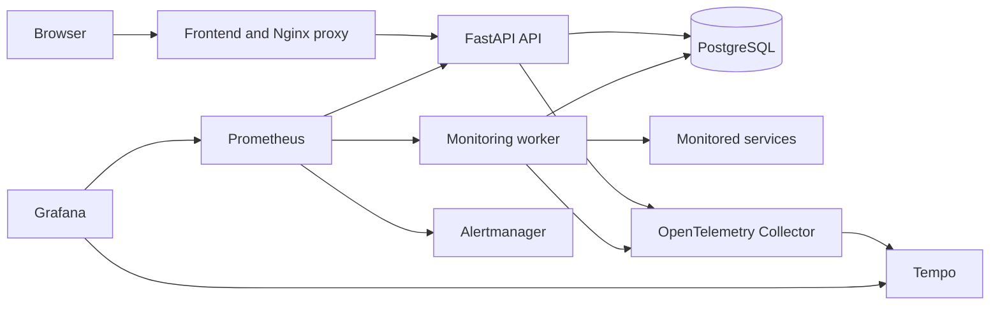
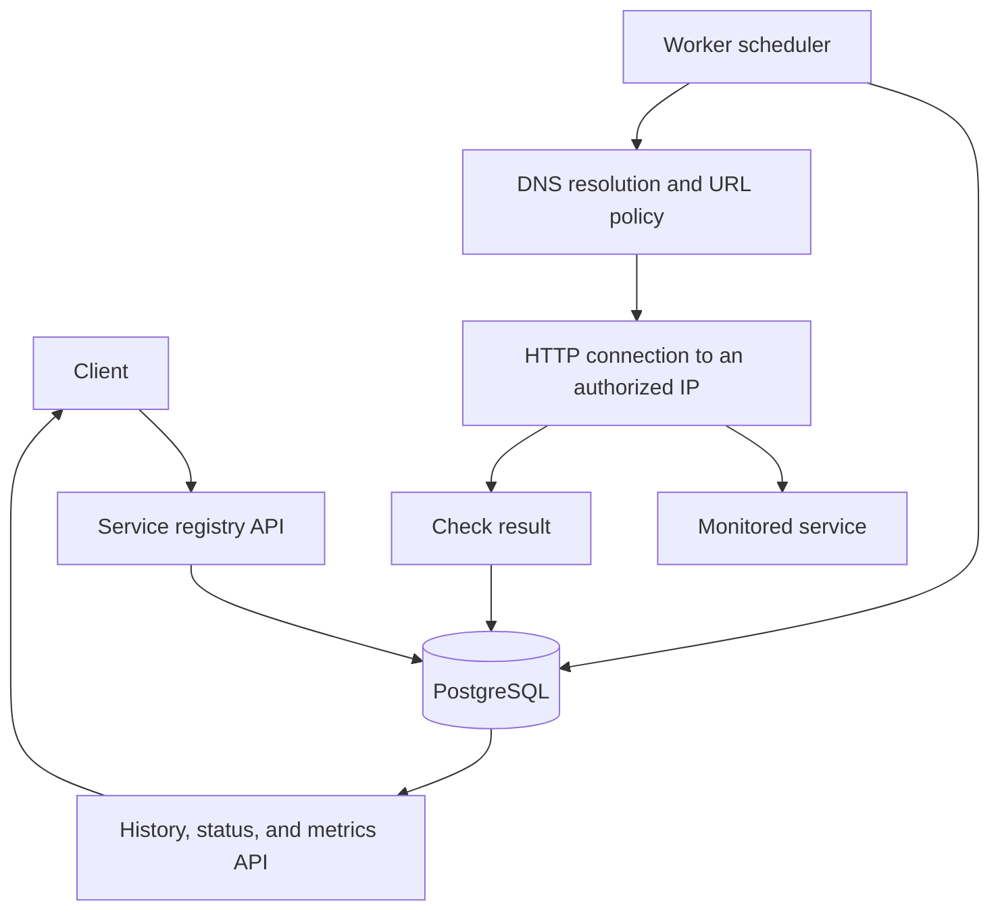
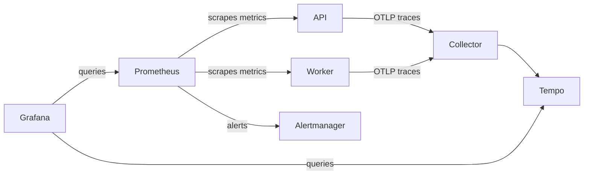
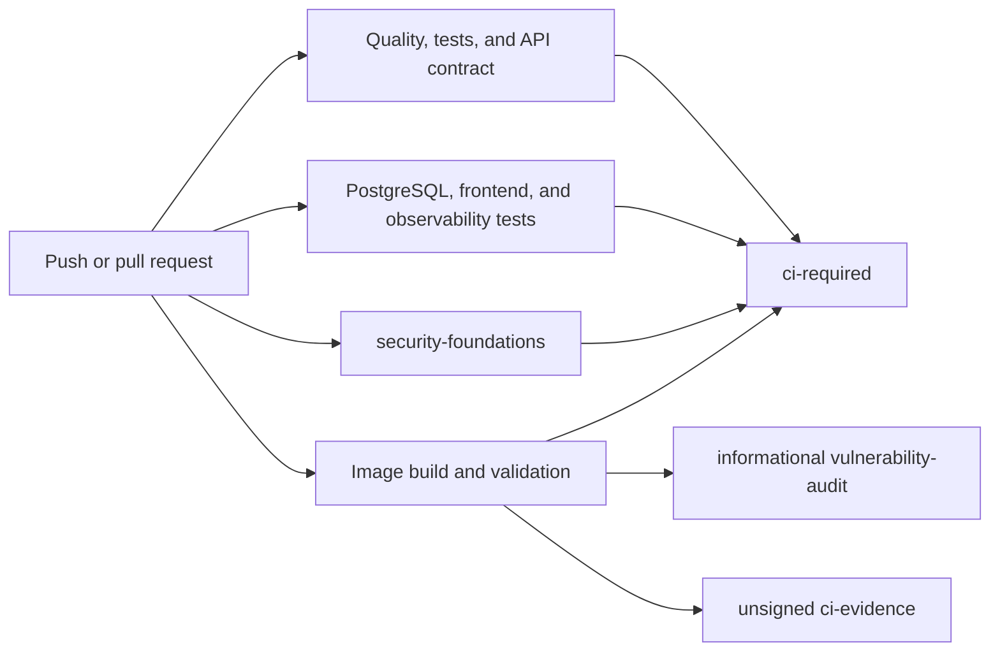

# InfraPulse architecture

This overview describes the local implementation and CI workflow in this checkout. The Compose stack is intended for development; the product does not provide authentication or authorization. See the decisions in the [ADRs](adr/0001-http-monitoring.md) and the [monitoring](operations/monitoring.md), [observability](operations/observability.md), and [frontend](operations/frontend.md) guides.

## System overview

The frontend, API, and Grafana are published on loopback by the Compose configuration. The worker is a separate process, and the current deployment design uses one replica. The arrows from Prometheus to the API and worker represent scraping metric listeners that are separate from the functional ports.

## API and worker

The policy validates the target before connecting while preserving the hostname for Host and TLS. The worker does not use proxies or redirects for checks. The API computes historical metrics from persisted results; PostgreSQL has no automatic retention. Details and limits are in [ADR 0001](adr/0001-http-monitoring.md) and the [monitoring guide](operations/monitoring.md).

## Observability

Traces are best effort. The default Alertmanager receiver is local, with no external notification integration. See [ADR 0002](adr/0002-observability-architecture.md) and the [operations guide](operations/observability.md).

## CI/CD

The diagram summarizes dependencies in the [CI workflow](../.github/workflows/ci.yml): `ci-required` aggregates its dependent jobs, while vulnerability auditing and evidence generation have separate results. It does not represent deployment or publication. Provenance and coverage limits are described in the [provenance guide](provenance-f3b1.md) and [CI evidence guide](ci-evidence-f3c2.md).
